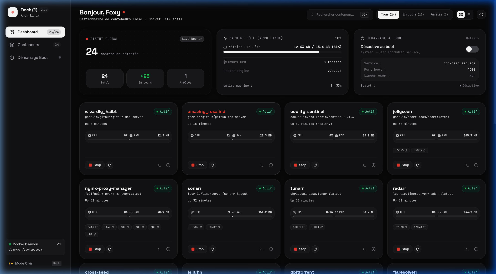

# Dock (1) — Local Container Control Deck
> **v26.1** • Minimalist Docker & Compose Management Deck inspired by **Nothing OS** & **Teenage Engineering**.

[](https://docker.thefoxy.me)
[](https://github.com/Julien0ff/App-docker/releases)
[](https://docker.thefoxy.me#downloads)
[](https://github.com/Julien0ff/App-docker)
[](LICENSE)

[**Français**](#-version-française) • [**English**](#-english-version)

---

<div align="center">
  
</div>

---

# 🇫🇷 Version Française

### Présentation
**Dock (1)** est une interface graphique de contrôle pour vos conteneurs et stacks Docker, pensée pour allier une esthétique épurée (noir profond `#080809`, rouge diode `#ea3829`, typographie géométrique, micro-animations tactiles) à des fonctionnalités d'administration complètes, sans jamais dépendre de la ligne de commande.

### 🌟 Fonctionnalités

1. **Création GUI de Conteneurs & Stacks (Zéro Ligne de Commande)** :
   - Déployez un conteneur autonome avec nom, image, ports, variables d'environnement, volumes et politique de redémarrage.
   - Déployez une stack Docker Compose avec des modèles prêts à l'emploi (Nginx, Redis, PostgreSQL, etc.) ou en collant votre fichier YAML.

2. **Éditeur Docker Compose Intégré** :
   - Détection automatique des fichiers `docker-compose.yml` réels de vos projets.
   - Édition directe du YAML dans un éditeur monospace avec numérotation de lignes.
   - Bouton **"Enregistrer & Relancer la stack"** qui applique les changements en temps réel (`docker compose up -d`).

3. **Webhooks Discord Granulaires & Rapports d'Uptime** :
   - Alertes temps réel pour le démarrage, arrêt, redémarrage, crash (`die`) ou suppression.
   - **Ciblage sur-mesure** : choisissez de recevoir les alertes pour tous les conteneurs ou uniquement pour des stacks ou conteneurs précis.
   - **Rapports d'état & Uptime** : bouton dédié pour envoyer un digest instantané de la santé et du temps de fonctionnement de vos services sur Discord.

4. **Système de Version CalVer & Mise à Jour Automatique** :
   - Versionnement **`26.1`** (Année `26` : 2026, Version `1`).
   - Détection automatique des nouvelles releases GitHub avec bannière de notification et lien direct.

5. **Multiplateforme & Bilingue (FR / EN)** :
   - Prise en charge native de **Linux**, **macOS** et **Windows** (Docker Desktop / WSL2).
   - Bascule de langue instantanée en un clic (`FR` ↔ `EN`).

6. **Démarrage au Boot (Linux systemd)** :
   - Service systemd utilisateur autonome avec mode `linger` pour lancer le serveur dès l'allumage de la machine, même sans session ouverte.

---

### 💻 Installation & Démarrage

#### Prérequis
- **Node.js** v18+ & **npm**
- **Docker** ou **Docker Desktop** actif sur votre machine

#### 1. Démarrage Rapide

```bash
# Cloner le dépôt
git clone https://github.com/foxy/dock-one.git
cd "dock-one"

# Installer les dépendances
npm install

# Lancer en mode production (accessible sur http://localhost:4500)
npm run build
npm start
```

#### 2. Mode Développement (HMR en direct)
```bash
npm run dev
# Interface de développement sur http://localhost:3000
```

#### 3. Installation par Système d'Exploitation

##### 🐧 Linux (Arch Linux, Ubuntu, Debian, Fedora)
- Connecte automatiquement au socket local `/var/run/docker.sock`.
- Pour activer le démarrage automatique au boot :
  ```bash
  npm run service:setup
  # Ou activez-le directement en 1 clic dans l'interface (Modal "Démarrage Boot")
  ```

##### 🍎 macOS
- Fonctionne directement avec Docker Desktop sur `/var/run/docker.sock` ou `~/.docker/run/docker.sock`.
- Lancez `npm start` ou configurez un agent `launchd` via `launchctl`.

##### 🪟 Windows (WSL2 / PowerShell)
- Assurez-vous que l'option *"Expose daemon on tcp://localhost:2375 without TLS"* ou le socket nommé (`//./pipe/docker_engine`) est actif dans les paramètres de Docker Desktop.
- Dans PowerShell :
  ```powershell
  npm install
  npm run build
  npm start
  ```

---

# 🇬🇧 English Version

### Overview
**Dock (1)** is a local management control deck for Docker containers and compose stacks, crafted with a high-end minimalist design inspired by **Nothing OS** and **Teenage Engineering** (deep `#080809` blacks, `#ea3829` indicator diode, geometric monospace accents, snappy tactile physics).

### 🌟 Key Features

1. **Zero-CLI Container & Stack Creator**:
   - Deploy standalone containers with custom names, images, port mappings, env variables, volumes, and restart policies.
   - Deploy multi-container Compose stacks with pre-configured templates (Nginx, Redis, Postgres) or custom YAML.

2. **In-App Docker Compose Editor**:
   - Automatically locates and parses actual `docker-compose.yml` files for existing stacks.
   - In-app YAML editor with line numbers, copy, download, and instant validation.
   - **"Save & Redeploy"** button executing real-time `docker compose up -d`.

3. **Granular Discord Webhooks & Uptime Reports**:
   - Real-time alerts for container start, stop, restart, crash (`die`), and delete events.
   - **Custom Scope Targeting**: select specific containers or compose stacks to watch.
   - **Live Health & Uptime Digests**: on-demand status reporting embedded with uptime tracking delivered to your Discord channel.

4. **CalVer Scheme & GitHub Auto-Update Alerts**:
   - Versioning **`26.1`** (Year `26`: 2026, Release `1`).
   - Built-in GitHub Releases checker querying for new tags and notifying you in the header.

5. **Multiplatform & Fully Bilingual (FR / EN)**:
   - Designed for **Linux**, **macOS**, and **Windows**.
   - One-click language switcher (`FR` ↔ `EN`) with state persistence.

6. **Linux Autostart (systemd)**:
   - User-space systemd service with user lingering support to run headless on boot.

---

### 💻 Installation & Quick Start

#### Requirements
- **Node.js** 18+ and **npm**
- **Docker Engine** or **Docker Desktop** running locally

```bash
git clone https://github.com/foxy/dock-one.git
cd "dock-one"
npm install
npm run build
npm start
```
The application will be served at **`http://localhost:4500`**.

---

### ⚙️ CI/CD & Multiplatform Builds

Automated GitHub Actions workflow (`.github/workflows/release.yml`) builds and packages standalone release archives for:
- **Linux x64**: `dock-one-linux-x64.tar.gz`
- **macOS Apple Silicon (ARM64)**: `dock-one-macos-arm64.tar.gz`
- **macOS Intel (x64)**: `dock-one-macos-x64.tar.gz`
- **Windows (x64)**: `dock-one-windows-x64.zip`

To create a new release:
```bash
git tag v26.1
git push origin v26.1
```

---

<div align="center">
  <sub>Designed with precision • Nothing OS & Teenage Engineering Philosophy</sub>
</div>
